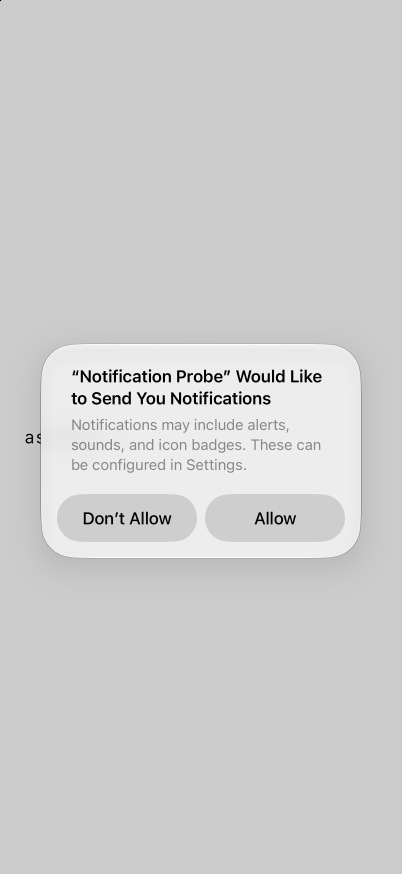

# ios-sim-notification-permission

A prototype for setting an app's **notification** permission on a booted iOS simulator
(grant, deny or reset) before the app asks, so UI tests never meet the
"Would Like to Send You Notifications" prompt.

`xcrun simctl privacy` can set most permissions, but not notifications. On iOS 27.2 it fails:

```
$ xcrun simctl privacy <udid> grant notifications <bundle-id>
Failed to create TCC authorization record
Operation not permitted
```

Notification permission isn't stored in TCC. SpringBoard keeps it in
`data/Library/BulletinBoard/VersionedSectionInfo.plist`, as one NSKeyedArchiver-encoded
`BBSectionInfo` per bundle id. That's the record it writes when a user answers the
prompt. [`set_notification_permission.py`](set_notification_permission.py) writes the
same record:

1. Stop SpringBoard and `usernotificationsd`, so neither writes its in-memory copy over the edit.
2. Write the app's `BBSectionInfo`: `authorizationStatus` 2 to grant or 1 to deny, or remove it to reset.
3. Start both services again. The app reads the new status on its next launch.

It needs Python 3 and the standard library only.

```bash
./set_notification_permission.py <udid> <bundle-id> grant --name "App Name"
./set_notification_permission.py <udid> <bundle-id> deny
./set_notification_permission.py <udid> <bundle-id> reset
```

The record is modelled on the one iOS 27.2 wrote after a user tapped **Allow** in the probe app.

## Verified

Tested on an iPhone 17 Pro simulator running iOS 27.2 (Xcode 27.2), with the
[probe app](probe/main.swift). The probe reads its status, calls
`requestAuthorization`, and shows both on screen; a prompt left on screen means the
status wasn't set beforehand. Build it with `probe/build.sh` and install it on the simulator.

| Step | The app shows |
| --- | --- |
| Fresh install, nothing set | the system prompt |
| `reset` on an app that was authorized | the system prompt again |
| `grant` | `before=authorized granted=true after=authorized`, no prompt |
| `deny` | `before=denied granted=false after=denied`, no prompt |
| Uninstall, reinstall, `grant` before the first launch | `before=authorized granted=true after=authorized`, no prompt |

Uninstalling an app removes its record, so a reinstall starts from "not determined" again.

| `reset` | `grant` |
| --- | --- |
|  |  |

## Limits

- This is a prototype, tested only on iOS 27.2. The archive format is private, and Apple can change it in any release.
- Restarting SpringBoard takes the simulator back to the home screen. Run it before you launch the app under test.
- It sets the app-level authorization only. Per-category settings (time-sensitive, critical alerts) keep their defaults.

Prior art: Wix's [applesimutils](https://github.com/wix/AppleSimulatorUtils) edits the same file for its `notifications` permission.
